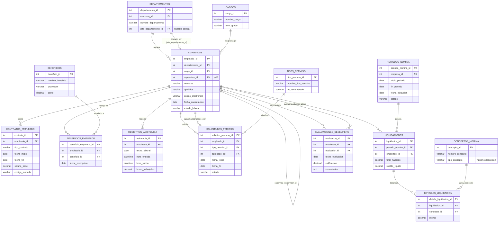

# Modelo Entidad-Relación (MER): Módulo de Recursos Humanos y Planilla

**Asignatura:** Modelación de Sistemas 2026-2 — Universidad de Concepción  
**Módulo:** 1. Recursos Humanos y Planilla (`HR / Payroll`)  
**Fuente:** Diagrama oficial del equipo (`modelo-entidadrelacion.png`) — 14 entidades  
**Compatibilidad:** ERP Base (`erp_data_model.md`)

---

## 1. Diagrama Entidad-Relación (Mermaid ERD)

Este código reproduce **exactamente** el diagrama oficial: mismas 14 entidades, mismos nombres de atributos y mismas relaciones.

> **Para regenerar la imagen:** pega este bloque en [mermaid.live](https://mermaid.live) y descarga en PNG/SVG.

---

## 2. Diccionario de Datos (14 entidades oficiales)

| # | Entidad | Campo (tipo) | Descripción |
|---|---|---|---|
| 1 | **DEPARTAMENTOS** | `departamento_id` (int, PK) | Identificador del área organizacional. |
| | | `empresa_id` (int, FK) | Empresa propietaria → `companies.company_id`. |
| | | `nombre_departamento` (varchar) | Nombre del área (Ventas, Producción, TI…). |
| | | `jefe_departamento_id` (int, FK, nullable) | Empleado que lidera el área → `EMPLEADOS.empleado_id` (referencia circular). |
| 2 | **CARGOS** | `cargo_id` (int, PK) | Identificador del puesto. |
| | | `nombre_cargo` (varchar) | Denominación del cargo. |
| | | `nivel_grado` (varchar) | Banda jerárquica/salarial (Junior, Senior, Jefatura). |
| 3 | **EMPLEADOS** | `empleado_id` (int, PK) | Identificador del colaborador. |
| | | `departamento_id` (int, FK) | Área a la que pertenece. |
| | | `cargo_id` (int, FK) | Cargo que ocupa. |
| | | `supervisor_id` (int, FK self) | Supervisor directo (auto-referencia). |
| | | `nombres` / `apellidos` (varchar) | Nombre completo. |
| | | `correo_electronico` (varchar) | Correo institucional. |
| | | `fecha_contratacion` (date) | Fecha de ingreso. |
| | | `estado_laboral` (varchar) | Activo / con licencia / desvinculado. |
| 4 | **CONTRATOS_EMPLEADO** | `contrato_id` (int, PK) | Identificador del contrato. |
| | | `empleado_id` (int, FK) | Trabajador contratado. |
| | | `tipo_contrato` (varchar) | Indefinido / plazo fijo / honorarios. |
| | | `fecha_inicio` / `fecha_fin` (date) | Vigencia del contrato. |
| | | `salario_base` (decimal) | **Remuneración pactada (dato confidencial).** |
| | | `codigo_moneda` (varchar, FK) → `currencies.currency_code` | Moneda de pago. |
| 5 | **BENEFICIOS** | `beneficio_id` (int, PK) | Identificador del beneficio. |
| | | `nombre_beneficio` (varchar) | Seguro complementario, bono colación, etc. |
| | | `proveedor` (varchar) | Entidad externa que lo presta. |
| | | `costo` (decimal) | Costo mensual del beneficio. |
| 6 | **BENEFICIOS_EMPLEADO** | `beneficio_empleado_id` (int, PK) | Identificador de la inscripción. |
| | | `empleado_id` (int, FK) | Empleado suscrito. |
| | | `beneficio_id` (int, FK) | Beneficio asignado. |
| | | `fecha_inscripcion` (date) | Inicio de la afiliación. |
| 7 | **REGISTROS_ASISTENCIA** | `asistencia_id` (int, PK) | Identificador de la marcación. |
| | | `empleado_id` (int, FK) | Trabajador que marcó. |
| | | `fecha_laboral` (date) | Día de la jornada. |
| | | `hora_entrada` / `hora_salida` (datetime) | Marcas de ingreso y salida. |
| | | `horas_trabajadas` (decimal) | Horas efectivas (base para horas extras). |
| 8 | **TIPOS_PERMISO** | `tipo_permiso_id` (int, PK) | Identificador del tipo de ausencia. |
| | | `nombre_tipo_permiso` (varchar) | Vacaciones, licencia médica, permiso administrativo. |
| | | `es_remunerado` (boolean) | Si el día se paga o se descuenta. |
| 9 | **SOLICITUDES_PERMISO** | `solicitud_permiso_id` (int, PK) | Identificador de la solicitud. |
| | | `empleado_id` (int, FK) | Solicitante. |
| | | `tipo_permiso_id` (int, FK) | Motivo tipificado. |
| | | `aprobado_por` (int, FK) | Jefatura que visó. |
| | | `fecha_inicio` / `fecha_fin` (date) | Período solicitado. |
| | | `estado` (varchar) | Pendiente / aprobada / rechazada. |
| 10 | **PERIODOS_NOMINA** | `periodo_nomina_id` (int, PK) | Identificador de la corrida mensual. |
| | | `empresa_id` (int, FK) → `companies` | Empresa que paga. |
| | | `inicio_periodo` / `fin_periodo` (date) | Mes computado. |
| | | `fecha_ejecucion` (date) | Fecha de cierre y pago. |
| | | `estado` (varchar) | Borrador / calculado / aprobado / cerrado. |
| 11 | **CONCEPTOS_NOMINA** | `concepto_id` (int, PK) | Identificador del concepto. |
| | | `nombre_concepto` (varchar) | Sueldo base, horas extras, AFP, salud, impuesto. |
| | | `tipo_concepto` (varchar) | `haber` o `deduccion`. |
| 12 | **LIQUIDACIONES** | `liquidacion_id` (int, PK) | Identificador de la liquidación. |
| | | `periodo_nomina_id` (int, FK) | Corrora a la que pertenece. |
| | | `empleado_id` (int, FK) | Trabajador liquidado. |
| | | `total_haberes` (decimal) | Suma bruta de ingresos. |
| | | `sueldo_liquido` (decimal) | Neto a transferir. |
| 13 | **DETALLES_LIQUIDACION** | `detalle_liquidacion_id` (int, PK) | Identificador del renglón. |
| | | `liquidacion_id` (int, FK) | Liquidación dueña. |
| | | `concepto_id` (int, FK) | Concepto aplicado. |
| | | `monto` (decimal) | Monto de ese concepto. |
| 14 | **EVALUACIONES_DESEMPENO** | `evaluacion_id` (int, PK) | Identificador de la evaluación. |
| | | `empleado_id` (int, FK) | Colaborador evaluado. |
| | | `evaluador_id` (int, FK) | Jefatura que evalúa. |
| | | `fecha_evaluacion` (date) | Fecha de la evaluación. |
| | | `calificacion` (decimal) | Puntaje objetivo (1.00 – 5.00). |
| | | `comentarios` (text) | Retroalimentación. |

---

## 3. Compatibilidad con la Estructura Base del ERP

Las 14 entidades se integran con el resto del ERP mediante 3 familias de enlaces:

| Origen (módulo RRHH) | Destino (ERP base) | Propósito |
|---|---|---|
| `DEPARTAMENTOS.empresa_id` | `companies.company_id` | Estructura organizacional multi-empresa. |
| `PERIODOS_NOMINA.empresa_id` | `companies.company_id` | Cada corrida de nómina pertenece a una razón social. |
| `CONTRATOS_EMPLEADO.codigo_moneda` | `currencies.currency_code` | Sueldos en CLP, USD o UF. |
| `DEPARTAMENTOS.departamento_id` | `cost_centers.department_id` (Finanzas) | Imputación del gasto de personal a presupuestos. |
| `PERIODOS_NOMINA.periodo_nomina_id` | `journal_entries.source_reference_id` (`source_module='payroll'`) | Asiento contable automático al cerrar la nómina. |
| `EMPLEADOS.empleado_id` | `sales_orders.employee_id` / `purchase_orders.employee_id` / `quality_inspections.inspector_id` / `customers.assigned_employee_id` | Maestro transversal de personal para todos los módulos. |
