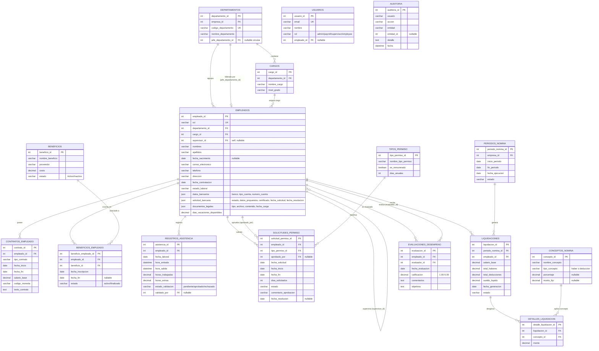

# Modelo Entidad-Relación (MER): Módulo de Recursos Humanos y Planilla

**Asignatura:** Modelación de Sistemas 2026-2 — Universidad de Concepción  
**Módulo:** 1. Recursos Humanos y Planilla (`HR / Payroll`)  
**Fuente:** Diagrama oficial del equipo (`modelo-entidadrelacion.png`) — 14 entidades  
**Compatibilidad:** modelo de datos oficial del ERP base (documentación del curso)  
**Extensión del MVP:** se conservan las 14 entidades oficiales y se agregan atributos extendidos en `DEPARTAMENTOS`, `CARGOS`, `EMPLEADOS`, `TIPOS_PERMISO`, `SOLICITUDES_PERMISO`, `CONTRATOS_EMPLEADO`, `BENEFICIOS`, `BENEFICIOS_EMPLEADO`, `LIQUIDACIONES` y `EVALUACIONES_DESEMPENO` para cubrir HU3, HU4, HU5 y HU11.

**Entidades de soporte:** además del MER oficial se persisten `USUARIOS` (cuentas y roles de demostración) y `AUDITORIA` (trazabilidad de acciones sensibles). No forman parte de las 14 entidades del diagrama oficial.

---

## 1. Diagrama Entidad-Relación (Mermaid ERD)

Este código reproduce las **14 entidades oficiales** y sus relaciones, e incorpora los atributos extendidos del MVP necesarios para los datos de contacto, bancarios, documentales y de saldo de permisos.

> **Para regenerar la imagen:** pega este bloque en [mermaid.live](https://mermaid.live) y descarga en PNG/SVG.  
> **Nota:** `modelo-entidadrelacion.png` corresponde al diagrama oficial de 14 entidades; los atributos extendidos del MVP se documentan en este archivo y deben incorporarse al regenerar la imagen.

---

## 2. Diccionario de Datos (14 entidades oficiales + atributos extendidos del MVP)

| # | Entidad | Campo (tipo) | Descripción |
|---|---|---|---|
| 1 | **DEPARTAMENTOS** | `departamento_id` (int, PK) | Identificador del área organizacional. |
| | | `empresa_id` (int, FK) | Empresa propietaria → `companies.company_id`. |
| | | `codigo_departamento` (varchar, UK) | Código único del área. |
| | | `nombre_departamento` (varchar) | Nombre del área (Ventas, Producción, TI…). |
| | | `jefe_departamento_id` (int, FK, nullable) | Empleado que lidera el área → `EMPLEADOS.empleado_id` (referencia circular). |
| 2 | **CARGOS** | `cargo_id` (int, PK) | Identificador del puesto. |
| | | `departamento_id` (int, FK) | Departamento al que pertenece el cargo (extensión MVP). |
| | | `nombre_cargo` (varchar) | Denominación del cargo. |
| | | `nivel_grado` (varchar) | Banda jerárquica/salarial (Junior, Senior, Jefatura); en el código se almacena como `nivel_jerarquia`. |
| 3 | **EMPLEADOS** | `empleado_id` (int, PK) | Identificador del colaborador. |
| | | `rut` (varchar, UK) | Identificación única del colaborador; obligatoria. |
| | | `departamento_id` (int, FK) | Área a la que pertenece. |
| | | `cargo_id` (int, FK) | Cargo que ocupa. |
| | | `supervisor_id` (int, FK self) | Supervisor directo (auto-referencia). |
| | | `nombres` / `apellidos` (varchar) | Nombre completo. |
| | | `fecha_nacimiento` (date, nullable) | Fecha de nacimiento; debe ser anterior a hoy. |
| | | `correo_electronico` (varchar) | Correo institucional único; en el código se almacena como `email`. |
| | | `telefono` / `direccion` (varchar) | Datos de contacto editables por el empleado. |
| | | `fecha_contratacion` (date) | Fecha de ingreso. |
| | | `estado_laboral` (varchar) | Activo / con licencia / desvinculado; en el código se almacena como `estado`. |
| | | `datos_bancarios` (json) | `banco`, `tipo_cuenta`, `numero_cuenta`; dato confidencial. |
| | | `solicitud_bancaria` (json) | `estado`, `datos_propuestos`, `certificado`, `fecha_solicitud`, `fecha_resolucion`; soporta la aprobación de RRHH de HU3 y bloquea una segunda solicitud pendiente. |
| | | `documentos_legales` (json) | `tipo`, `archivo`, `contenido`, `fecha_carga`; documentos requeridos en el alta de HU4. |
| | | `dias_vacaciones_disponibles` (decimal) | Saldo vigente de días de vacaciones del colaborador. |
| 4 | **CONTRATOS_EMPLEADO** | `contrato_id` (int, PK) | Identificador del contrato. |
| | | `empleado_id` (int, FK) | Trabajador contratado. |
| | | `tipo_contrato` (varchar) | Indefinido / plazo fijo / honorarios. |
| | | `fecha_inicio` / `fecha_fin` (date) | Vigencia del contrato. |
| | | `salario_base` (decimal) | **Remuneración pactada (dato confidencial).** |
| | | `codigo_moneda` (varchar, FK) → `currencies.currency_code` | Moneda de pago. |
| | | `texto_contrato` (text) | Contrato editable generado desde la plantilla con los datos del colaborador. |
| 5 | **BENEFICIOS** | `beneficio_id` (int, PK) | Identificador del beneficio. |
| | | `nombre_beneficio` (varchar) | Seguro complementario, bono colación, etc. |
| | | `proveedor` (varchar) | Entidad externa que lo presta. |
| | | `costo` (decimal) | Costo mensual del beneficio. |
| | | `estado` (varchar) | `Activo` / `Inactivo`; solo los activos admiten inscripciones. |
| 6 | **BENEFICIOS_EMPLEADO** | `beneficio_empleado_id` (int, PK) | Identificador de la inscripción. |
| | | `empleado_id` (int, FK) | Empleado suscrito. |
| | | `beneficio_id` (int, FK) | Beneficio asignado. |
| | | `fecha_inscripcion` (date) | Inicio de la afiliación. |
| | | `fecha_fin` (date, nullable) | Fin de la afiliación; nulo mientras está activa. |
| | | `estado` (varchar) | `activo` o `finalizado`; permite bloquear duplicados y calcular costos por período. |
| 7 | **REGISTROS_ASISTENCIA** | `asistencia_id` (int, PK) | Identificador de la marcación. |
| | | `empleado_id` (int, FK) | Trabajador que marcó. |
| | | `fecha_laboral` (date) | Día de la jornada. |
| | | `hora_entrada` / `hora_salida` (datetime) | Marcas de ingreso y salida. |
| | | `horas_trabajadas` (decimal) | Horas efectivas (base para horas extras). |
| | | `horas_extras` (decimal) | Horas extras calculadas sobre la jornada. |
| | | `estado_validacion` (varchar) | Pendiente / aprobado / rechazado por la jefatura. |
| | | `validado_por` (int, FK, nullable) | Jefatura que validó las horas extras. |
| 8 | **TIPOS_PERMISO** | `tipo_permiso_id` (int, PK) | Identificador del tipo de ausencia. |
| | | `nombre_tipo_permiso` (varchar) | Vacaciones, licencia médica, permiso administrativo. |
| | | `es_remunerado` (boolean) | Si el día se paga o se descuenta. |
| | | `dias_anuales` (int) | Días anuales disponibles del tipo de permiso; base para calcular el saldo. |
| 9 | **SOLICITUDES_PERMISO** | `solicitud_permiso_id` (int, PK) | Identificador de la solicitud. |
| | | `empleado_id` (int, FK) | Solicitante. |
| | | `tipo_permiso_id` (int, FK) | Motivo tipificado. |
| | | `aprobado_por` (int, FK) | Jefatura que visó. |
| | | `fecha_solicitud` (date) | Fecha en que se creó la solicitud. |
| | | `fecha_inicio` / `fecha_fin` (date) | Período solicitado. |
| | | `dias_solicitados` (int) | Días solicitados; se valida contra el saldo disponible. |
| | | `estado` (varchar) | Pendiente / aprobada / rechazada. |
| | | `comentario_aprobacion` (varchar) | Comentario de aprobación o rechazo de la jefatura; obligatorio al rechazar. |
| | | `fecha_resolucion` (date, nullable) | Fecha en que la jefatura aprobó o rechazó la solicitud. |
| 10 | **PERIODOS_NOMINA** | `periodo_nomina_id` (int, PK) | Identificador de la corrida mensual. |
| | | `empresa_id` (int, FK) → `companies` | Empresa que paga. |
| | | `inicio_periodo` / `fin_periodo` (date) | Mes computado. |
| | | `fecha_ejecucion` (date) | Fecha de cierre y pago. |
| | | `estado` (varchar) | Borrador / calculado / aprobado / cerrado. |
| 11 | **CONCEPTOS_NOMINA** | `concepto_id` (int, PK) | Identificador del concepto. |
| | | `nombre_concepto` (varchar) | Sueldo base, horas extras, AFP, salud, impuesto. |
| | | `tipo_concepto` (varchar) | `haber` o `deduccion`. |
| | | `porcentaje` (decimal, nullable) | Porcentaje aplicado sobre la base de cálculo, si corresponde. |
| | | `monto_fijo` (decimal, nullable) | Monto fijo del concepto, si corresponde. |
| 12 | **LIQUIDACIONES** | `liquidacion_id` (int, PK) | Identificador de la liquidación. |
| | | `periodo_nomina_id` (int, FK) | Corrida de nómina a la que pertenece; en el código se usa `periodo_id`. |
| | | `empleado_id` (int, FK) | Trabajador liquidado. |
| | | `salario_base` (decimal) | Sueldo base prorrateado por los días de contrato dentro del período. |
| | | `total_haberes` (decimal) | Suma bruta de ingresos. |
| | | `total_deducciones` (decimal) | Suma de descuentos; debe cumplir `sueldo_liquido = total_haberes - total_deducciones`. |
| | | `sueldo_liquido` (decimal) | Neto a transferir; en el código se almacena como `salario_neto`. |
| | | `fecha_generacion` (date) | Fecha de ejecución del cálculo. |
| | | `estado` (varchar) | Estado heredado del período al momento del cálculo. |
| 13 | **DETALLES_LIQUIDACION** | `detalle_liquidacion_id` (int, PK) | Identificador del renglón. |
| | | `liquidacion_id` (int, FK) | Liquidación dueña. |
| | | `concepto_id` (int, FK) | Concepto aplicado. |
| | | `monto` (decimal) | Monto de ese concepto. |
| 14 | **EVALUACIONES_DESEMPENO** | `evaluacion_id` (int, PK) | Identificador de la evaluación. |
| | | `empleado_id` (int, FK) | Colaborador evaluado. |
| | | `evaluador_id` (int, FK) | Jefatura que evalúa. |
| | | `fecha_evaluacion` (date) | Fecha de la evaluación; no puede ser futura. |
| | | `calificacion` (decimal) | Puntaje objetivo (1.00 – 5.00), admite decimales. |
| | | `comentarios` (text) | Retroalimentación obligatoria. |
| | | `objetivos` (text) | Objetivos acordados; obligatorio. |
| 15 | **USUARIOS** *(soporte)* | `usuario_id` (int, PK) | Cuenta de demostración. |
| | | `email` (varchar, UK) / `nombre` | Credenciales y nombre visible. |
| | | `rol` (varchar) | `admin`, `payroll`, `supervisor` o `employee`. |
| | | `empleado_id` (int, FK, nullable) | Ficha vinculada; los cambios de rol se guardan en `hr.rolesUsuarios`. |
| 16 | **AUDITORIA** *(soporte)* | `auditoria_id` (int, PK) | Identificador del evento. |
| | | `usuario`, `accion`, `entidad`, `entidad_id`, `detalle`, `fecha` | Trazabilidad de acciones sensibles; se conservan los últimos 500 eventos. |

---

## 3. Compatibilidad con la Estructura Base del ERP

Las 14 entidades se integran con el resto del ERP mediante 3 familias de enlaces:

| Origen (módulo RRHH) | Destino (ERP base) | Propósito |
|---|---|---|
| `DEPARTAMENTOS.empresa_id` | `companies.company_id` | Estructura organizacional multi-empresa. |
| `PERIODOS_NOMINA.empresa_id` | `companies.company_id` | Cada corrida de nómina pertenece a una razón social. |
| `CONTRATOS_EMPLEADO.codigo_moneda` | `currencies.currency_code` | Sueldos en CLP, USD o UF. |
| `DEPARTAMENTOS.departamento_id` | `cost_centers.department_id` (Finanzas) | Imputación del gasto de personal a presupuestos. |
| `PERIODOS_NOMINA.periodo_nomina_id` | `journal_entries.source_reference_id` (`source_module='payroll'`) | Asiento contable automático al cerrar la nómina. |
| `EMPLEADOS.empleado_id` | `sales_orders.employee_id` / `purchase_orders.employee_id` / `quality_inspections.inspector_id` / `customers.assigned_employee_id` | Maestro transversal de personal para todos los módulos. |

---

## 4. Trazabilidad con las Historias de Usuario

| Historia | Entidades principales | Propósito |
|---|---|---|
| HU1 — Departamentos | `DEPARTAMENTOS`, `EMPLEADOS` | Estructura organizacional y jefe de área. |
| HU2 — Cargos | `CARGOS`, `EMPLEADOS`, `CONTRATOS_EMPLEADO` | Catálogo de puestos y niveles de grado. |
| HU3 — Datos personales | `EMPLEADOS` (`telefono`, `direccion`, `datos_bancarios`, `solicitud_bancaria`) | Autoservicio de contacto y datos bancarios con aprobación de RRHH. |
| HU4 — Altas y contratos | `EMPLEADOS` (`rut`, `documentos_legales`), `CONTRATOS_EMPLEADO`, `CARGOS`, `DEPARTAMENTOS` | Ingreso de personal y formalización contractual. |
| HU5 — Permisos | `TIPOS_PERMISO` (`dias_anuales`), `SOLICITUDES_PERMISO` (`dias_solicitados`), `EMPLEADOS` (`dias_vacaciones_disponibles`) | Solicitud, aprobación y saldo de ausencias. |
| HU6 — Asistencia | `REGISTROS_ASISTENCIA`, `EMPLEADOS` | Marcaciones diarias y horas trabajadas. |
| HU7 — Nómina | `PERIODOS_NOMINA`, `CONCEPTOS_NOMINA`, `LIQUIDACIONES`, `DETALLES_LIQUIDACION`, `CONTRATOS_EMPLEADO` | Cálculo y consulta de liquidaciones. |
| HU8 — RBAC | `USUARIOS`, `AUDITORIA`, `EMPLEADOS` (ficha vinculada) | Control de acceso, roles y trazabilidad. |
| HU9 — Horas extras | `REGISTROS_ASISTENCIA`, `CONCEPTOS_NOMINA`, `DETALLES_LIQUIDACION` | Validación de horas extras antes de nómina. |
| HU10 — Beneficios | `BENEFICIOS`, `BENEFICIOS_EMPLEADO`, `EMPLEADOS` | Catálogo e inscripción de beneficios. |
| HU11 — Evaluaciones | `EVALUACIONES_DESEMPENO`, `EMPLEADOS` | Evaluación periódica de subordinados directos. |

---

## 5. Reglas de Integridad y Validación

- `DEPARTAMENTOS.codigo_departamento` y `nombre_departamento` son obligatorios y únicos.
- Un `DEPARTAMENTOS.departamento_id` no puede eliminarse si tiene `EMPLEADOS` o `CARGOS` asociados; la interfaz ofrece reasignarlos.
- Un `CARGOS.cargo_id` no puede eliminarse si está asignado a empleados o referenciado por contratos vigentes.
- `CARGOS.departamento_id` debe existir y el cargo debe pertenecer al mismo departamento del empleado.
- `EMPLEADOS.supervisor_id` puede ser nulo (nivel sin jefatura); si existe, debe referenciar a otro empleado de la misma empresa y no puede generar ciclos.
- `EMPLEADOS.rut` es obligatorio y único; `correo_electronico` es obligatorio y único. El alta no se persiste sin ellos.
- `EMPLEADOS.fecha_nacimiento` debe ser anterior a hoy cuando se informa.
- `CONTRATOS_EMPLEADO.fecha_fin` debe ser igual o posterior a `fecha_inicio`; `salario_base` debe ser mayor que cero. `Indefinido` y `Honorarios` admiten fecha nula; `Plazo fijo` exige fecha de término.
- `CONTRATOS_EMPLEADO.codigo_moneda` debe ser `CLP`, `USD` o `UF`.
- Un empleado no puede tener contratos con fechas superpuestas, aunque uno de ellos no tenga fecha de término.
- `REGISTROS_ASISTENCIA` es único por (`empleado_id`, `fecha_laboral`); `hora_salida` debe ser posterior a `hora_entrada` y `fecha_laboral` no puede ser futura.
- `REGISTROS_ASISTENCIA.horas_extras` se calcula sobre una jornada base de 9 horas y solo se consolida en nómina cuando `estado_validacion = aprobado`; no puede aprobarse dos veces.
- `SOLICITUDES_PERMISO.fecha_fin` debe ser igual o posterior a `fecha_inicio`; no se permiten solicitudes pendientes o aprobadas superpuestas para el mismo empleado.
- La dotación mínima del MVP es 1: una aprobación se bloquea si no queda ningún empleado activo disponible en el departamento para esas fechas.
- `SOLICITUDES_PERMISO.aprobado_por` y `fecha_resolucion` se registran al aprobar o rechazar.
- `LIQUIDACIONES` es única por (`periodo_nomina_id`, `empleado_id`); un recálculo actualiza la liquidación existente. Requiere un contrato con al menos un día de superposición con el período.
- El sueldo base de la liquidación se prorratea por los días de superposición entre contrato y período.
- `DETALLES_LIQUIDACION.monto` se clasifica como haber o deducción según `CONCEPTOS_NOMINA.tipo_concepto`.
- `BENEFICIOS.estado = Activo` es requisito para inscribir; no se permiten dos inscripciones activas del mismo empleado en el mismo beneficio.
- `BENEFICIOS_EMPLEADO.fecha_fin` debe ser igual o posterior a `fecha_inscripcion`; una inscripción activa tiene `fecha_fin` nula.
- El costo de beneficios se prorratea por los días de inscripción activa dentro del período.
- `EMPLEADOS.documentos_legales` debe incluir los documentos obligatorios definidos para el alta y conservar la metadata de cada archivo.
- `EMPLEADOS.datos_bancarios` es confidencial; un cambio solo se aplica cuando `solicitud_bancaria.estado` pasa de `Pendiente` a `Aprobada` por RRHH, deja auditoría y no existe otra solicitud pendiente.
- `EMPLEADOS.dias_vacaciones_disponibles` no puede ser negativo; una solicitud aprobada descuenta los días y una rechazada no modifica el saldo.
- `SOLICITUDES_PERMISO.dias_solicitados` se calcula desde el rango de fechas y no puede superar el saldo disponible del empleado para tipos de vacaciones.
- `SOLICITUDES_PERMISO.comentario_aprobacion` es obligatorio al rechazar y opcional al aprobar.
- `CONTRATOS_EMPLEADO.texto_contrato` conserva el contrato editable generado desde la plantilla predefinida.
- `LIQUIDACIONES.total_deducciones` debe ser igual a la suma de los detalles clasificados como deducción y debe cumplirse `sueldo_liquido = total_haberes - total_deducciones`.
- `EVALUACIONES_DESEMPENO.calificacion` debe estar entre 1.00 y 5.00, admite decimales, y el evaluador debe ser jefe directo del evaluado.
- Los registros históricos de nómina, contratos y evaluaciones no se eliminan; se conservan para auditoría.
- La eliminación de un empleado se bloquea si tiene contratos, liquidaciones, evaluaciones o personas a cargo; en caso contrario se eliminan en cascada su asistencia, solicitudes de permiso e inscripciones de beneficios.
- Los cambios de salario, datos bancarios, roles y reapertura de períodos generan un registro de auditoría; se conservan los últimos 500 eventos.
- Un período `Cerrado` solo puede reabrirse a `Aprobado` por un administrador, con auditoría; el recálculo posterior actualiza las liquidaciones sin duplicarlas.
- `USUARIOS` y `AUDITORIA` son colecciones de soporte; no se incluyen en las 14 entidades oficiales.

---

## 6. Mapeo entre el MER oficial y la implementación del MVP

La implementación conserva el significado del MER, pero usa nombres abreviados en algunas colecciones de `localStorage`. Este mapeo es la referencia para pruebas, contrato de almacenamiento y futuras migraciones:

| MER oficial | Implementación (`src/hr`) | Nota |
|---|---|---|
| `EMPLEADOS.correo_electronico` | `email` | Mismo dato y validación de unicidad. |
| `EMPLEADOS.estado_laboral` | `estado` | `Activo`, `Con licencia`, `Desvinculado`. |
| `CARGOS.nivel_grado` | `nivel_jerarquia` | Misma banda jerárquica. |
| `CONTRATOS_EMPLEADO.codigo_moneda` | `moneda` | `CLP`, `USD`, `UF`. |
| `SOLICITUDES_PERMISO.solicitud_permiso_id` | `solicitud_id` | Clave primaria de la colección. |
| `PERIODOS_NOMINA.periodo_nomina_id` | `periodo_id` | Clave primaria de la colección. |
| `PERIODOS_NOMINA.inicio_periodo` / `fin_periodo` | `fecha_inicio` / `fecha_fin` | Mismo rango. |
| `PERIODOS_NOMINA.fecha_ejecucion` | `fecha_generacion` | Fecha de cálculo/cierre. |
| `LIQUIDACIONES.sueldo_liquido` | `salario_neto` | Mismo neto calculado. |
| `DETALLES_LIQUIDACION.detalle_liquidacion_id` | `detalle_id` | Clave primaria de la colección. |
| `CONCEPTOS_NOMINA.tipo_concepto = haber/deduccion` | `Haber` / `Deducción` | Se normaliza sin distinguir mayúsculas. |

Las claves de almacenamiento del MVP se documentan en `contracts/hr-storage.md`; las 14 entidades oficiales se mantienen y las dos colecciones de soporte se añaden al mismo prefijo `hr.`.
